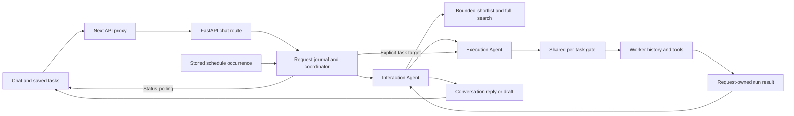

# OpenPoke

A local conversational assistant with persistent task workers, Gmail tools and scheduled work. This fork adds bounded worker discovery, explicit task continuation, request-owned execution and a responsive interface. See [engineering decisions](docs/tradeoffs.md), the [five-minute walkthrough](docs/walkthrough.md) and [validation evidence](docs/validation.md).

## What changed

- **Execution Agent Overload:** the Interaction Agent receives at most eight saved workers / 4,096 serialized UTF-8 bytes, with paginated lookup over the full roster. Older workers and their history remain saved.
- **Continue a task:** select an existing worker explicitly for a follow-up. Its authoritative ID is validated server-side, avoiding a second model routing decision.
- **Request ownership:** each request records its worker runs, received partial output and terminal state. Same-worker work is serialized; independent workers can run concurrently. Restart records interruption instead of replaying external actions.
- **Frontend:** a searchable saved-work sidebar, task history, composed prompt bar, streaming output, activity filters and email-shaped replies. Email subject and recipients share one header. Reply actions are grouped, continuation shows the task name, and status distinguishes a saved draft from an incomplete response.

This is a local, single-process take-home slice. The overload fix bounds the worker directory, not total conversation or worker history. Live testing exposed paraphrase lookup failures and context-limit failures; see [limits](#limits).

## Setup

Validated on macOS with Python 3.12.13 and Node 26/npm 11. Python dependencies are pinned in `server/requirements.lock`; JavaScript dependencies use `web/package-lock.json`.

```sh
git clone https://github.com/Dannny-Babs/openpoke.git
cd openpoke
git switch feat/bounded-task-discovery
python3.12 -m venv .venv
.venv/bin/python -m pip install -r server/requirements.lock
npm ci --prefix web
```

For uv-managed Python, use `uv venv --python 3.12 .venv`, then `uv pip install --python .venv/bin/python -r server/requirements.lock`.

The implementation branch is local until published. These clone instructions retrieve the implementation only after `feat/bounded-task-discovery` has been pushed; the current local checkout already contains it.

Create the local environment file without overwriting an existing one:

```sh
if [ ! -e .env ]; then cp .env.example .env; fi
```

Enter secrets through your local editor and never commit them. Existing shell variables take precedence over the file.

| Credential | Needed for |
| --- | --- |
| `OPENROUTER_API_KEY` | Live agent replies and model-powered background work; calls may cost money |
| `COMPOSIO_API_KEY` and `COMPOSIO_GMAIL_AUTH_CONFIG_ID` | Optional Gmail integration, followed by Settings → Gmail authorization |
| None | Scripted offline demo, task browsing, tests and frontend build |

## Start and stop

For the disposable offline demo, start the backend in one terminal:

```sh
.venv/bin/python scripts/preview.py --demo
```

In another terminal:

```sh
OPENPOKE_DEMO=1 PY_SERVER_URL=http://127.0.0.1:8001 npm run dev --prefix web -- --hostname 127.0.0.1
```

Open [the app](http://127.0.0.1:3000). Backend health: [API health](http://127.0.0.1:8001/api/v1/health). Stop both terminals with Ctrl+C. For a production frontend preview, run `npm run build --prefix web`, then replace `dev` with `start`.

The demo copies server source into temporary storage, blanks integration credentials and blocks external HTTP. Replies are deterministic fixtures, not live AI. Try “Draft an email to Nora”, continue that task with “Make it shorter and say Friday works”, then remove the target and ask about subscriptions. Include “slow” to see pending work or “fail” to simulate failure. Sample reminders are history only; nothing is scheduled. `--empty` starts with no sample history. Exit deletes temporary records.

For isolated live model testing with an approved budget, use a persistent budget receipt:

```sh
.venv/bin/python scripts/live_preview.py --budget-ledger /tmp/openpoke-approved-test-budget.json
OPENPOKE_LIVE_TEST=1 OPENPOKE_LIVE_BUDGET_USD=2 PY_SERVER_URL=http://127.0.0.1:8001 npm run dev --prefix web -- --hostname 127.0.0.1
```

This mode uses fictional temporary history and Gemini 2.5 Flash Lite through your saved OpenRouter key by default. Add `--model anthropic/claude-sonnet-4` to test the app’s default model. Its profile permits at most 10 calls, reserves US$0.20 per call, and limits input to 24,000 UTF-8 bytes and output to 1,536 tokens; the Gemini profile permits 20 calls at US$0.10 each. The default approval remains US$2. Only after an explicit additional US$5 approval, add `--budget-usd 5`; this permits 25 Sonnet reservations (or 50 Gemini reservations). Set the frontend’s `OPENPOKE_LIVE_BUDGET_USD=5` as well so its label matches that approved cap. A higher approval does not raise an older receipt’s lower call limit; that receipt remains tied to its original approval. Gmail, external worker tools and background jobs are disabled. The test harness bounds input size, output tokens and provider prices and refuses a receipt belonging to a different model. Reservations include failed/timed-out calls and are not a billing report. Reuse the same receipt across restarts; deleting it or choosing a new path would create a new budget. The banner identifies this test mode. Ctrl+C removes temporary app records while retaining the budget receipt.

If a frontend port is occupied, choose an unused one and add `--port 3016` to the npm command. The current local review uses frontend port 3016 and backend port 8015; those are session-specific, not required ports. Check the exact listener before stopping a process. Stop only your own frontend/backend terminals with Ctrl+C.

The fixture routing evaluation submits model requests only with an explicit flag:

```sh
.venv/bin/python scripts/evaluate_routing.py --submit --case continuation --output /tmp/openpoke-routing-result.json
```

Use `--case fallback` to require a worker outside the initial shortlist and observe a successful search tool call before exact reuse. It requires the isolated live harness; a fixture-only preflight does not prove model search behavior. Use `--case reuse` for model-selected reuse of the fictional Lisbon worker, or `--case separate` for new-task creation. `--case all` runs all three; one conversation can consume several model calls, so the cap may stop later cases. A passing case verifies the recorded task ID and terminal status; inspect its reply separately for semantic correctness. Cases can require several provider calls and may consume the remaining approved budget. `--case all` covers continuation, reuse and separate creation; run fallback explicitly before other cases to preserve its absent-shortlist precondition. Live sample findings, including failures, are recorded in [the latest live receipt](docs/live-evaluation-2026-10-11.json).

To use persistent data and live models instead:

```sh
.venv/bin/python -m server.server --host 127.0.0.1 --port 8001
PY_SERVER_URL=http://127.0.0.1:8001 npm run dev --prefix web -- --hostname 127.0.0.1
```

This app has no account-level access control. Keep it on loopback and use one backend process. Live Gmail tools can change a mailbox; the draft display is not a general tool-approval enforcement layer.

## Checks

```sh
.venv/bin/python scripts/test_backend.py
npm run lint --prefix web
npm run build --prefix web
git diff --check
```

The backend runner compiles a disposable source copy and runs 55 tests with fake workers/providers. It excludes real runtime data and credentials. Coverage includes bounded directory/history payloads, older-worker lookup, exact continuation, collision guards, overlapping request ownership, same-task serialization, failures, retry deduplication, shutdown/restart interruption, schedule occurrence receipts and active/idle history clearing, fragmented provider streams, partial-output isolation, malformed tool arguments and interrupted streams. These tests do not establish live routing quality or exactly-once external effects.

For the portable browser suite, build first, install its browser runtime once, then run:

```sh
npm exec --prefix web -- playwright install chromium --only-shell
npm run test:browser --prefix web
```

The thirty-six checks start their own disposable offline backend/frontend on ports 8003/3013 and refuse to reuse existing servers. They cover safe Markdown and links, navigation/focus, concurrent requests, stale and out-of-order status, partial isolation, terminal failure and real loopback HTTP dispatch to two independent scripted workers. Desktop uses 1440×1000 and annotated-layout checks use 1035×1090; mobile uses 390×844 at normal browser scale. No model calls or mailbox actions occur. `scripts/browser_regression.js` and `scripts/browser_concurrency.js` are reusable page functions invoked by this suite, not standalone Node commands.

The composed interface adapts Beautiful UI Prompt Bar, Chat/Streaming Text, Sidebar Nav, Recommendation Card, Selection Actions, local prompt review and Filter Table, with Lucide icons and Sonner feedback. Type `/` for editable starter prompts or `@` to target a saved task. The shortcut button appends a template as a separate paragraph without replacing existing text. Choose or dismiss an open suggestion menu before sending; Escape dismisses it. Choosing another worker removes any pending quote tied to the previous worker, and removing the task clears its pending quote while keeping your draft. Highlight an answer or choose Ask about reply to prepare a quoted follow-up; only Send dispatches it. Activity searches and filters request receipts loaded in the session. Clear removes just the search; Show all activity resets search and status filters. View request focuses its original message without dispatching. On mobile, origin/time appear below the task so status and navigation stay visible. Email-shaped output keeps its subject, supplied To/From/Cc/Date and body in both chat and saved history. Only draft records say Not sent; other output says Delivery not tracked. Quoted headers remain ordinary text. See [component guide](docs/composed-ui.md) for the code map and boundaries, and [walkthrough](docs/walkthrough.md) for a short demo.

Your messages searches requests loaded in the conversation. Opening or canceling it preserves the saved-task reader and its scroll position; choosing a result switches to that message. New task removes pending quoted follow-up context and the task target while keeping unsent text.

Saved work opens on its newest bounded page in the main reading pane. Load earlier preserves reading position, and refresh keeps already loaded context. Inspection is read only; Continue returns to the conversation with the exact task selected for the next request and its name as the heading. The saved-task list uses compact, vertically centered rows; touch pointers retain a 44px minimum target. Same-request, same-worker draft commentary retains its text without a second toolbar, while different workers retain their own actions. Sidebar search and New task stay reachable while its list scrolls. Enter sends and Shift + Enter inserts a newline. Demo settings disable integration requests; sending waits until app mode is verified. See [UI review](docs/ui-review.md) for reviewed captures.

Clean Python and npm setup are checked from the pinned manifests in a separate disposable copy. See `docs/validation.md` for the current browser and setup evidence and limitations.

## Request path



`web/app/page.tsx` sends an optional task target and unique submission ID. `server/routes/chat.py` accepts the input and returns a request ID. `server/services/execution/request_coordinator.py` owns its worker phases and final reply. Inspection never dispatches work; Continue selects a task whose exact worker is validated and reused without model routing.

The Interaction Agent's initial worker directory contains at most eight entries/4,096 UTF-8 bytes. `server/services/execution/directory.py` searches the complete roster with bounded pages, so older workers remain available. This bounds directory context, not the whole prompt. `batch_manager.py` gates history loading and execution for each task across chat and schedules; different tasks can run concurrently.

`server/data/` stores conversation, roster, worker logs, preferences, schedules and `requests.sqlite3`. Restart marks incomplete requests/runs interrupted. It does not replay chat requests. Interrupted scheduled occurrences are held for manual review rather than repeated automatically. Clear history rejects active work, then clears conversation/task/schedule/request content; hashed submission receipts remain to reject replay of cleared requests.

## Limits

Live evidence is mixed and the sample is small. Earlier isolated tests verified explicit continuation and model-selected reuse. The later absent-shortlist Portugal/Lisbon paraphrase case failed after five search calls and hit the test harness's 24,000-byte input guard. Separate-task creation selected the correct worker and completed, but its final reply also mentioned the earlier failed request. User follow-ups produced a saved email draft followed by an incomplete response as context grew. These are unresolved discovery/context-quality failures, not successful evaluations. No overall accuracy percentage or before/after speed improvement is claimed.

Lexical names can miss paraphrases, and full conversation and worker histories remain unbounded. Task keys hash exact legacy names and do not survive renaming. Mixed legacy filename histories are blocked, not migrated. This is a single-process harness, with no durable workflow resumption, full context compaction, webhook ingress, extra model providers or runtime skill registry. Production dependencies pass `npm audit --omit=dev`; 23 development/build-tool advisories remain (19 high, four moderate). Next.js is pinned to 15.5.27 with React 19.2.8; see validation for the update rationale.

## License

MIT — see [LICENSE](LICENSE). Original project: [shlokkhemani/openpoke](https://github.com/shlokkhemani/openpoke), [architecture explainer](https://www.shloked.com/openpoke).

The sidebar rail/recent rows and worker status rows adapt free Beautiful UI source. See [third-party notices](THIRD_PARTY_NOTICES.md) for source links and MIT attribution. The task rows use real run statuses rather than the reference’s demonstration timers.
