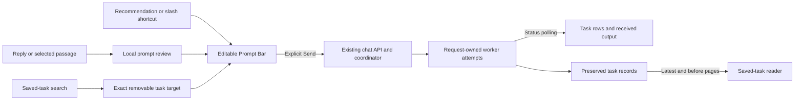

# Composed interface — 11 October 2026

This pass implements the approved Beautiful UI direction using public MIT component source. Registry URLs and license notices are retained in [third-party notices](../THIRD_PARTY_NOTICES.md).

| Before | After | Why |
| --- | --- | --- |
| Plain composer | Prompt Bar with removable task chip, `/` shortcuts and `@` saved-task search | Prepare and target the next request together |
| Generic empty screen | Recommendation Card with editable starter prompts | Help users begin without automatically sending |
| Dense response labels | Chat/Streaming Text composition, Lucide actions and Sonner feedback | Give the answer more space |
| Follow-ups needed retyped context | Selection Actions and local prompt review | Quote a passage and choose an instruction before sending |
| Scattered activity | Searchable Filter Table over loaded request receipts | Inspect actual work without invented spending data |
| Oldest history page first | Latest bounded page, Load earlier and Latest | Reach the current result and retain older context |

## Where each part lives

- [PromptBar](../web/components/ui/PromptBar.tsx): `/draft`, `/compare` and `/summarize` insert templates. `@` queries the existing bounded task API. Enter stays local while suggestions are unresolved or empty. Escape dismisses the menu. Picking a saved task sets its exact ID without dispatching. An open suggestion menu guards both Send and form submission until choosing or dismissing it. The shortcut button ignores task-query text and appends a template on a separate paragraph. Task-search loading/errors apply only to the task picker.
- [RecommendationCard](../web/components/ui/RecommendationCard.tsx): app-supplied starter suggestions fill the composer; no invented confidence score.
- [ChatMessages](../web/components/chat/ChatMessages.tsx) and [StreamingReply](../web/components/ui/StreamingReply.tsx): conversation, drafts, copy/continue/follow-up actions and received worker text. Existing browser polling remains; no artificial token-reveal timer or private reasoning transcript.
- [SelectionActions](../web/components/ui/SelectionActions.tsx): one-answer text selection, real clipboard copying and quoted-context callbacks. [PromptReviewCard](../web/components/ui/PromptReviewCard.tsx) prepares an editable instruction and excerpt, bounded to 2,000 characters. “Ask about reply” is the keyboard alternative. Choosing another worker discards a pending quote tied to a different worker; matching-worker continuation preserves it. Removing the task clears its task-owned pending quote without changing the draft. Changed quote content/task keys reset local review instruction state. Only Send dispatches work.
- [MessageNavigator](../web/components/chat/MessageNavigator.tsx): searches loaded user requests. It lives outside both readers; opening/canceling leaves the selected task and scroll intact. Choosing a result deliberately switches to All messages and focuses that request. New task clears pending quoted review/target while preserving unsent typing.
- [ActivityTable](../web/components/ui/ActivityTable.tsx): Base UI dialog, search and status filters over requests loaded in this session. Clear search retains the status filter; Show all activity resets both and focuses search. View request switches to its original message and clears unrelated pending quote review, while preserving draft text and the explicit composer target. Mobile keeps task/status/action visible with origin/time under the task. This is not an all-time journal or billing report.
- [SidebarRows](../web/components/ui/SidebarRows.tsx), [TaskDrawer](../web/components/tasks/TaskDrawer.tsx) and [TaskRow](../web/components/ui/TaskRow.tsx): adapted Sidebar Nav/Task Rows retain application-owned task IDs, actual phases and server search/pagination.

The Approval Card adaptation is **local prompt review**, not external-tool authorization. No new Gmail permissions or universal send-approval layer were introduced.

## Recent-history tradeoff

[TaskHistory](../web/components/tasks/TaskHistory.tsx) starts with `latest=true&limit=20`, then loads earlier chronological pages using exclusive `before` parsed-record offsets. Pages remain bounded to 20 records and 32,768 serialized UTF-8 bytes. Prepending and refresh preserve the visible record; refresh merges new outcomes into loaded context. A large gap has an explicit Load missing activity action.

[TaskDirectory](../server/services/execution/directory.py) retains the offset API for compatibility. [ExecutionAgentLogStore](../server/services/execution/log_store.py) scans legacy append-only logs while retaining a bounded suffix. This avoids migration, but scan time still grows with file length. Record offsets assume append-only history. Stored worker history, execution and whole-context compaction are unchanged. Legacy timestamps without an offset preserve recorded wall time instead of inventing a UTC instant.

## Evidence boundary

See the latest entry in [validation](validation.md) and the composed-interface receipt. Temporary-store backend tests, intercepted browser fixtures, local HTTP with scripted workers and earlier paid-model samples are separate evidence categories. This pass makes no paid model calls or Gmail actions. Physical-device keyboards, screen-reader use, broad live routing quality and real integrations remain unverified.

## Email presentation and final checks

[EmailReply](../web/components/ui/EmailReply.tsx) is an application-specific composition inside the existing Beautiful UI Chat/StreamingText adaptation. It is not a newly installed email library or a claimed Beautiful UI email component. `StreamingReply` uses it in both conversation and saved-task history. A complete leading To/Subject header block and body are required; optional From/Cc/Date are shown exactly as supplied. Plain or bold field labels and CRLF are accepted. Quoted headers, explanations and incomplete output remain prose. Draft-role records alone show Not sent; saved/generic email-shaped records show Delivery not tracked. Provider partials show In progress. No mailbox thread IDs, delivery metadata or send capability are invented. Copy continues to use the unchanged original record; task ownership, logs and API contracts are unchanged.

Fresh setup installed 47 Python and 403 npm packages, then passed 55 backend tests, lint, types/build and 33 browser checks. Email cases cover desktop/mobile history and exact continuation, copying, streaming, fallback prose and escaped HTML. See [final email receipt](email-final-checks-2026-10-11.json). No paid-model or mailbox actions occurred in this pass.
