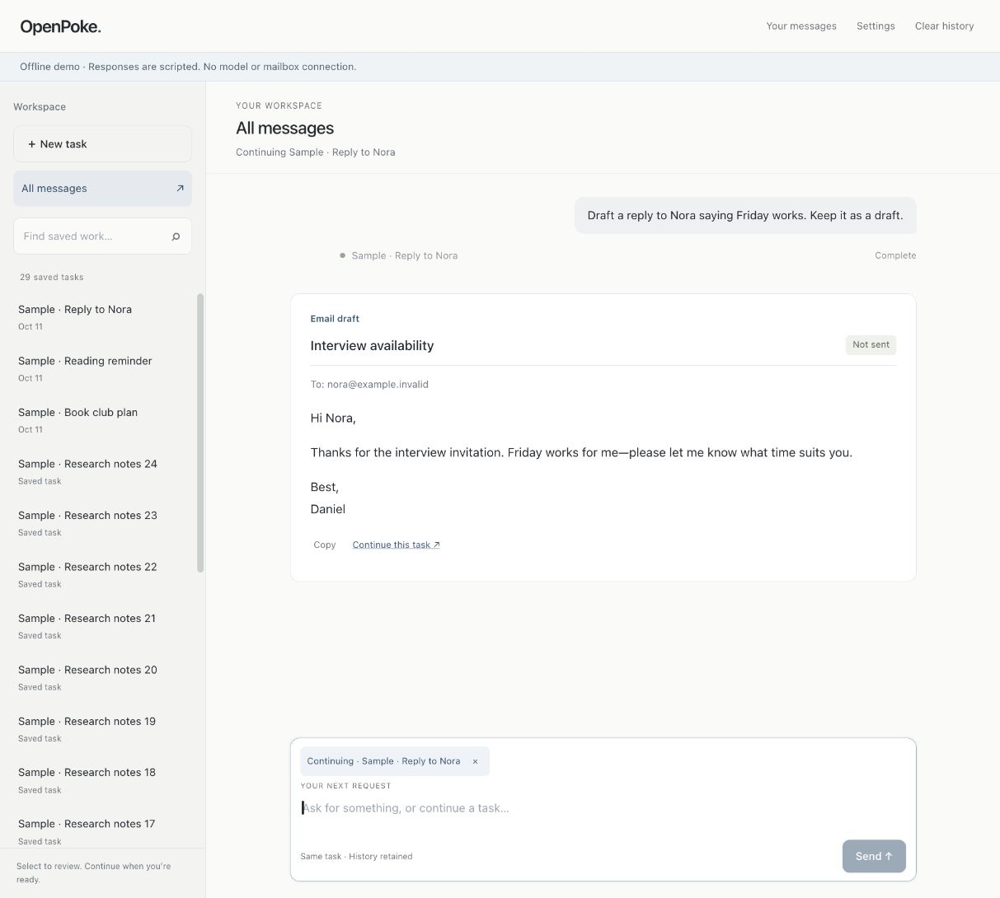
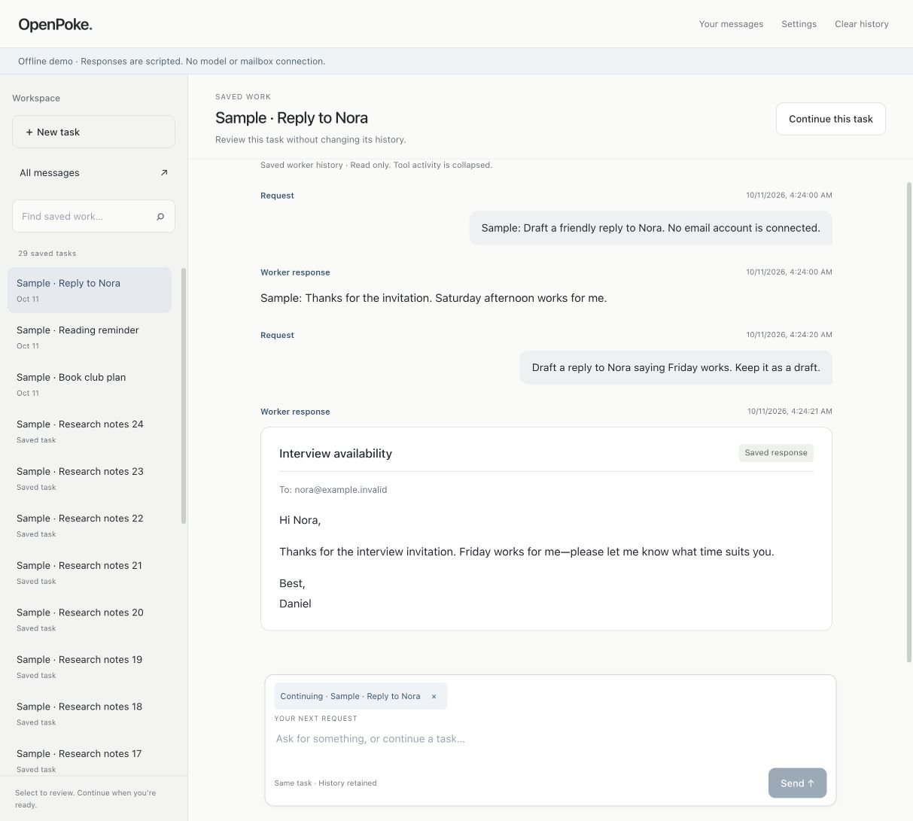
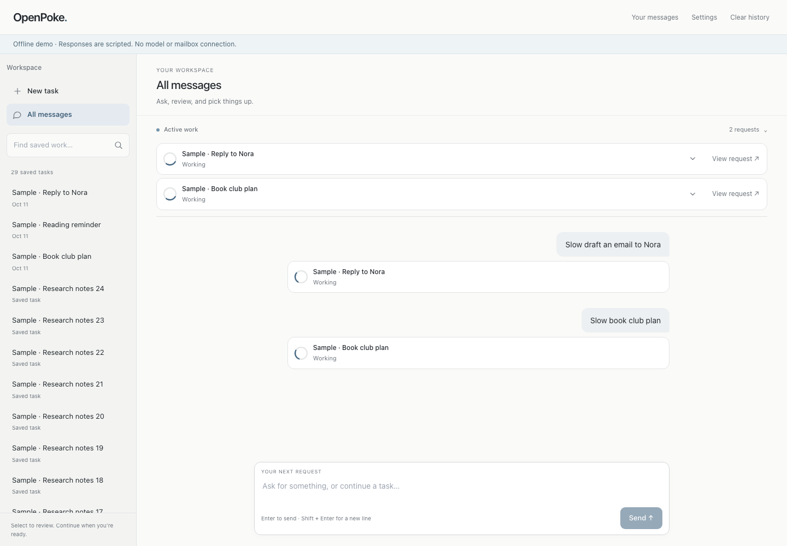
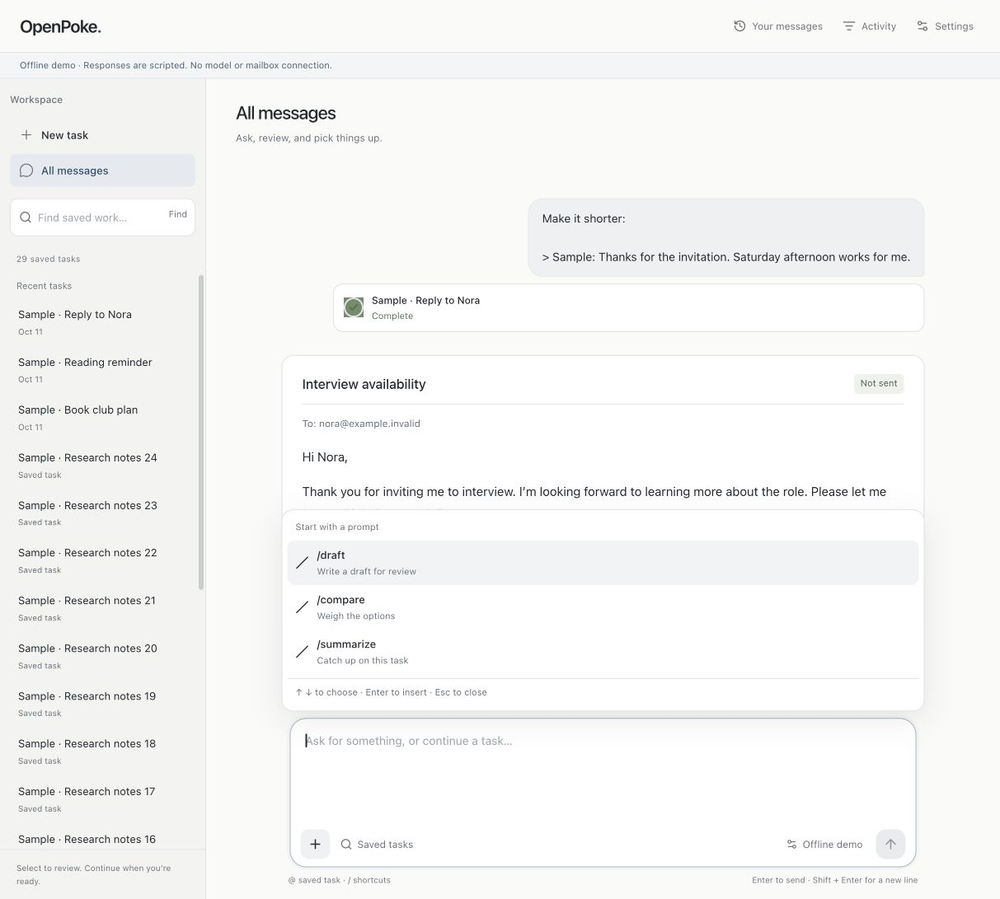
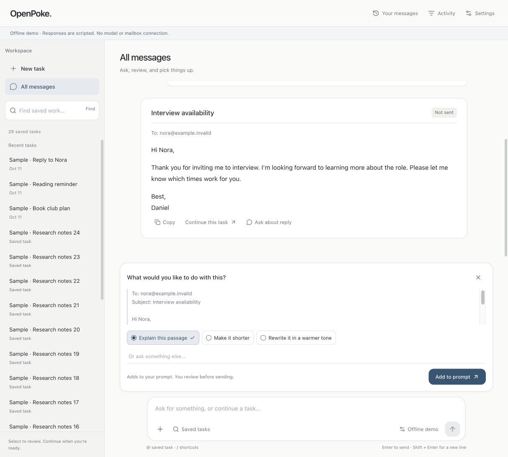
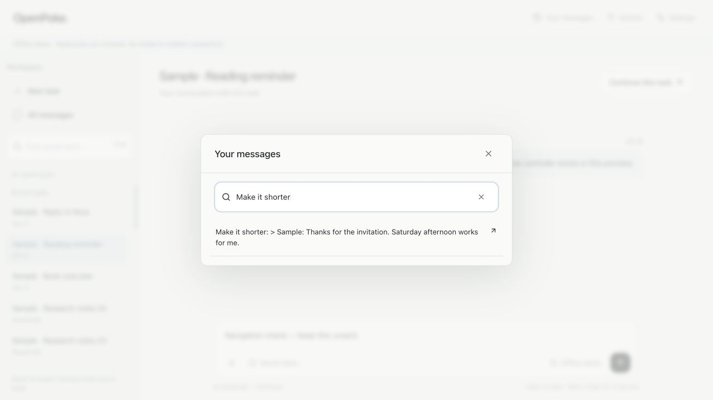
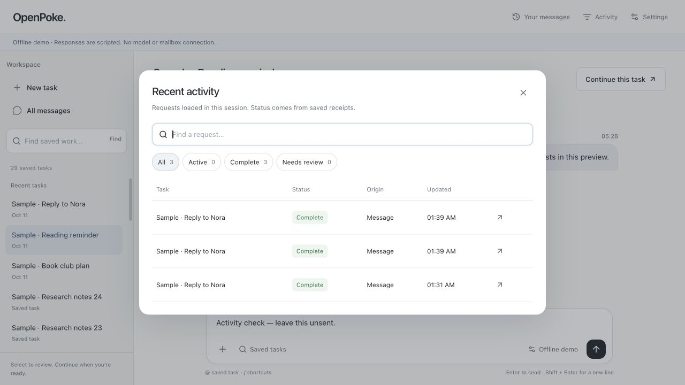
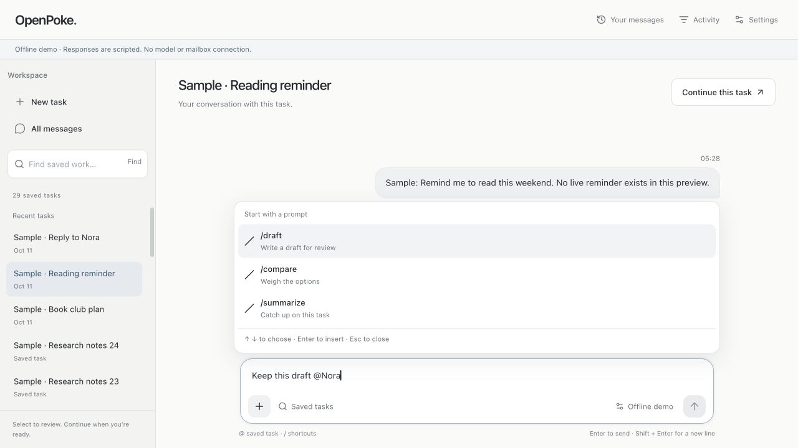
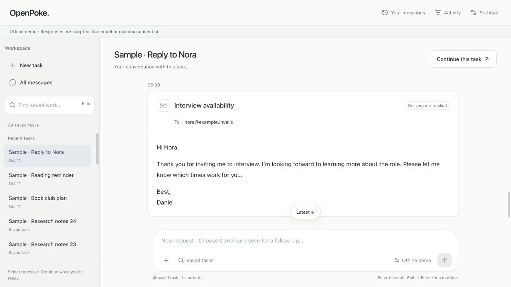

# Task workspace review — 11 October 2026

Current composition and evidence: [component guide](composed-ui.md) and [29-check composer receipt](composer-refinement-2026-10-11.json). Earlier checkpoints below are retained as history; the newest captures are at the end.

The intended user is returning to several ongoing tasks and wants to review a result or continue the right task. This approved pass addresses the observed interaction defects. It supersedes the earlier blanket 4.0 visual rating, which did not expose the scrolling and navigation problems found during a direct walkthrough.

| Before | After | Why |
| --- | --- | --- |
| Task history appeared in a modal over unrelated conversation | Selected task, selected row and read-only history in the main pane | Make the current reading context clear |
| Sidebar header and search scrolled away with its rows | Fixed workspace controls, one independently scrolling task list | Keep navigation reachable during long-history exploration |
| Expanded global activity reduced the reading viewport | Small collapsed overview, available in both reading contexts | Keep concurrent workers visible without competing with their output |
| Final result was 415px below the viewport after a send | Shared follow-latest state, content and viewport resizing observed | Follow results when pinned; preserve deliberate reading when away |
| Draft continuation was labeled Email draft | Real worker name, with exact-ID metadata lookup for older drafts | Keep the actual task identity and display name together |
| Sending lost composer focus | Restore after acknowledgment/rejection unless focus moved elsewhere | Support repeated interactions without stealing navigation focus |
| Demo settings attempted Gmail status and showed an error | Explicit disabled-mode explanation and guarded integration controls | Distinguish deliberate isolation from a broken connection |
| Unresolved app mode could be treated as live | Dispatch disabled until a valid mode response arrives | Avoid acting under misleading mode information |

Base UI 1.9.0 provides the accessible mobile navigation dialog. The sidebar and message presentation are application components; native transcript scrolling remains because a styled scrollbar does not solve anchoring. [Base UI dialog](https://base-ui.com/react/components/dialog) and [license](https://github.com/mui/base-ui/blob/master/LICENSE) were inspected. [Beautiful UI](https://www.beautifului.dev/) was inspected in the in-app browser, particularly its quiet workspace hierarchy and concise task/tool presentation. It has an [MIT license](https://www.beautifului.dev/license); the subsequent component pass adapts its SidebarNav rail/recent rows and TaskRows ring, badges and expandable row structure. [Third-party notices](../THIRD_PARTY_NOTICES.md) retain copyright, MIT terms and registry source URLs. Demo state, workspace switching and invite controls are excluded. Kobra informed the conversation-local message navigator, readable responses and source treatment. No paid component source, percentages or private reasoning traces were added.

Older worker records do not contain reliable request IDs or typed draft delivery metadata. The task pane therefore shows a labeled timeline of known requests/responses and collapsed tool activity. Email-shaped saved responses get recipient/subject/body formatting and a Saved response label, not an inferred Not sent claim. Continue returns to All messages with the explicit worker target. Merely selecting a task neither dispatches work nor silently changes an existing composer target. Paginated history starts at the beginning; when more records exist, its jump button explicitly says Bottom of loaded history.

Reviewed at normal scale: desktop task pane and completed follow-up, mobile 390×844 result and navigation, and disabled Demo settings. Captures contain fictional demo data only. Checklist: shared transcript/composer edges, restrained selection contrast, stable controls, readable message grouping, request-owned output, no ornamental animation, explicit continuation, keyboard focus, Escape restoration and no horizontal overflow. These are rendered observations and automated browser checks, not screen-reader or physical-device proof. No new numeric craft score or publishability claim is made.

[Mobile result](ui/workspace-mobile-final.png), [mobile navigation](ui/workspace-mobile-sidebar-final.png), [Demo settings](ui/workspace-demo-settings-final.png).

The running-app check used request `164fef96-1fa4-4e38-8c09-f0e9bd328573`, reached succeeded with Sample · Reply to Nora, retained composer focus and had a measured bottom gap of 0px. Its model response is scripted. The production browser suite passes eleven checks, including long completion, preserved reading position, background completion during task inspection, 40-row paging, exact-ID older-draft lookup, rejection recovery, failed mode detection and cancellation of an in-flight older-task lookup. See [workspace receipt](workspace-checks-2026-10-11.json).

The subsequent free-component integration keeps the application-owned IDs, server-backed pagination/search and Base UI mobile dialog. One status row replaces duplicate progress headings; details appear only when tool activity, provisional output, multiple runs or an error exist. Activity disclosure is user-controlled and remains collapsed during polling updates. Reduced motion disables the indeterminate ring. There are no timed failures, invented progress percentages or automatic retries. No new package dependency was added.

| Before | After | Why |
| --- | --- | --- |
| Text-glyph sidebar actions and oversized new-task control | Adapted icon-aligned rail rows with quieter spacing | Make navigation consistent and reduce competing containers |
| Plain active-worker text rows | Adapted status ring and expandable task rows | Scan worker identity and actual phase together |
| Initial integration repeated status and exposed empty details | One row per request; disclosure only for real detail | Keep the conversation readable without redundant decoration |

Production lint/build and all **12 browser checks passed** on the final component source (22.1s). The added regression proves real failure remains failed, user-collapsed details survive streaming updates, keyboard disclosure works and reduced motion stops the ring. The backend was unchanged and its prior 53-check result was not rerun for this presentation-only pass. The earlier clean-install result predates this adaptation. Screenshots below use disposable scripted workers, including two requests through real local HTTP, not paid models or Gmail. See [component receipt](beautiful-ui-checks-2026-10-11.json).

[Adapted sidebar](ui/beautiful-sidebar-desktop.png) · [Mobile result](ui/beautiful-integration-mobile.png)

## Current composed interface — 11 October 2026

This supersedes the earlier beginning-first history and components-only descriptions above. Prompt Bar now combines exact task targets, slash prompts and saved-task search. Chat/Streaming Text renders received output; Recommendation Card fills editable starters; Selection Actions and local review prepare quoted follow-ups; Filter Table presents actual loaded request activity. Lucide and Sonner are pinned dependencies with retained license notices. See [the code guide](composed-ui.md) for the component-to-system map and tradeoffs.

The reader starts at the latest bounded page and can load earlier records. Refresh preserves the visible record and keeps already loaded context. A review card prepares input and does not approve external tool actions. No gallery source/confidence/timed-response data is presented as application evidence.

All 18 final browser checks passed, including actual copy feedback, rejection recovery, newest history, exact targeting and mobile review. The in-app browser was also inspected at an actual 390×844 CSS viewport: zero horizontal overflow and Add to prompt remained visible. The activity backdrop problem found by tests is corrected; filters and Escape focus were exercised afterward. Captures show fictional offline data. See [current receipt](composed-ui-checks-2026-10-11.json).

[Mobile review](ui/composed-review-mobile.png) · [Activity table](ui/composed-activity-desktop.png) · [Completed conversation](ui/composed-conversation-desktop.png)

## Navigation refinement — 11 October 2026

| Before | After | Why |
| --- | --- | --- |
| Canceling Your messages switched away from the selected saved task | Navigator opens independently; cancel preserves reader, scroll and trigger focus | Inspect navigation without losing your place |
| New task retained a quoted review tied to the previous worker | Clears pending quote and target, keeps unsent text and focuses the composer | Prevent old follow-up context from restoring the wrong task |
| Message navigator required scanning every loaded request | Local searchable requests with clear and empty feedback | Find an earlier request deliberately |

Both defects were manually reproduced and proved by regressions against the previous build. All 21 final browser checks, lint and production build passed. Manual mobile inspection at 390×844 found zero horizontal overflow; search is 16px to avoid focus zoom. Search only covers loaded conversation requests. Native search Escape clears a nonempty query first; another Escape closes the dialog and restores trigger focus. No live model or Gmail testing occurred.

[Mobile reader](ui/openpoke-navigation-mobile-final.png) · [Mobile message search](ui/openpoke-navigation-mobile-search-final.png) · [Receipt](navigation-checks-2026-10-11.json)

## Activity inspection and recovery — 11 October 2026

| Before | After | Why |
| --- | --- | --- |
| View request retained a quote from another task | Clears pending quoted review; preserves unsent draft and explicit target | Keep reading navigation from restoring unrelated follow-up context |
| Empty activity search required manually erasing text and changing filters | Clear search and Show all activity return focus to the input | Recover locally without leaving the reader |
| Mobile table pushed the navigation action offscreen | Task/status/action stay visible; origin/time sit under the task name | Reach the request without sideways scrolling |
| Filtered tasks still said Recent tasks and 1 matching tasks | Search results and singular/plural count | Describe the actual list |

Final 24-check browser suite passed in 26.7s. Lint, production build and diff checks pass; backend and dependencies are unchanged. Manual desktop behavior and automated 390×844 mobile behavior are separate evidence. No live model or Gmail test was performed. Screenshots use fictional offline records.

[Empty filter recovery](ui/openpoke-activity-empty-final.png) · [Mobile activity](ui/openpoke-activity-mobile-final.png) · [Receipt](activity-refinement-2026-10-11.json)

## Composer targeting and quote state — 11 October 2026

| Before | After | Why |
| --- | --- | --- |
| A quote could retain its previous worker after selecting another | Different-worker selection discards pending quote; matching-worker continuation preserves it | Keep explicit worker choice and quoted context consistent |
| Shortcut button inherited task search and could have no choices | All shortcut commands available; insertion appends a separate paragraph | Preserve existing typing and support keyboard preparation |
| Pointer Send remained available while task suggestions were unresolved | Send and form submission wait for choosing or dismissing suggestions | Match keyboard behavior and prevent premature dispatch |
| New reply reused the previous custom instruction | Changed quote/task remounts fresh review state | Keep instructions specific to the selected reply |

All 29 browser checks passed in 28.7s; build, lint/types and diff checks pass. The four regression failures on the previous build are retained in the receipt. Backend and dependencies are unchanged, and live semantic quality was not evaluated. The keyboard/menu and worker-switch walkthrough was also exercised manually without sending.

[Fresh quote review](ui/openpoke-composer-review-final.png) · [Receipt](composer-refinement-2026-10-11.json)

## Email presentation — final pass

| Before | After | Why |
| --- | --- | --- |
| Saved email replies lose subject/recipient layout | One email card renderer in chat, saved history and received partials | Preserve the document shape through continuation |
| Conversation draft parser duplicated display logic | Shared conservative header parser with unchanged raw copy text | Keep presentation consistent without migrating records |
| Worker output cannot prove delivery | Draft-role records say Not sent; saved/generic output says Delivery not tracked | Preserve the difference between content and mailbox evidence |
| Partial or quoted headers could be misread | Complete leading headers/body required; other text remains prose | Avoid inventing email metadata |

Manual browser inspection confirmed the current saved Nora history; no records were changed. Fresh desktop/mobile fixtures passed 33 total browser checks. [Receipt](email-final-checks-2026-10-11.json).

| Before | After | Why |
| --- | --- | --- |
| Live mode always displayed US$2 | Live mode displays the configured public approval cap; unknown cap says Budget capped | Match the current US$5 reservation limit without exposing credentials |

The final configured-cap regression passes within 34 browser checks. In-app refresh/navigation was blocked by the browser client; HTTP and fixture evidence do not substitute for a fresh live screenshot.

## Annotated workspace refinement — 2026-10-11

| Before | After | Why |
| --- | --- | --- |
| Subject and recipient occupied separate header sections | Subject, recipient and supplied metadata share one header | Reads as one email document |
| Large failure and completion cards with stacked labels | Compact status rows, colored text badges and manual details | State remains readable without overpowering the result |
| A saved draft could sit under an unexplained Failed label | Draft saved · Reply incomplete, plus an explanation; failure state retained | Separates produced output from request completion |
| Find text beside a search icon | One labeled icon submit button; Enter still searches | Removes redundant text while retaining keyboard and accessible names |
| Draft, commentary and composer repeated follow-up controls | One draft toolbar; same-task commentary has none; Continue hides when already selected | Reduces competing actions without removing text or another worker's controls |
| A date under every task | Task names only; history ambiguity warning preserved | Uses sidebar space for useful navigation |
| Full-width test banner | Rounded, contained mode badge with the same cap and integration facts | Mode stays visible without occupying a full bar |
| All messages stayed the heading during continuation | Active task name becomes the heading | Confirms where the next message will go |
| Instructional footer below the sidebar | Footer removed | Removes persistent explanatory clutter |

Verification uses isolated scripted data and the existing local offline HTTP harness. No model calls, Gmail requests or external actions were made for this refinement. The live context-limit failure remains unresolved and is not disguised as completion. The backend and current live test records were preserved while only the frontend restarted.

| Before | After | Why |
| --- | --- | --- |
| Saved-task rows inherited a 48px minimum and top-aligned labels | 36px desktop rows with vertically centered labels; 44px minimum for touch pointers | Fits more saved work without shrinking touch targets or clipping two-line titles |
